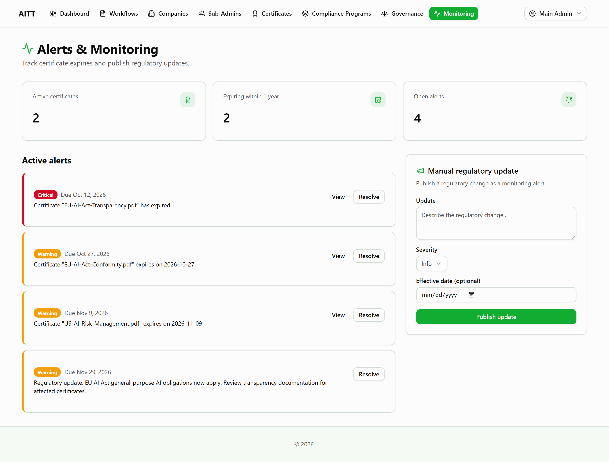
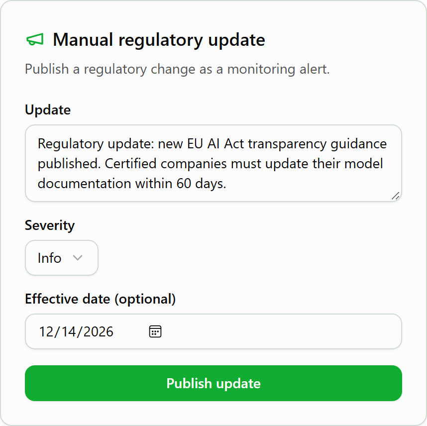
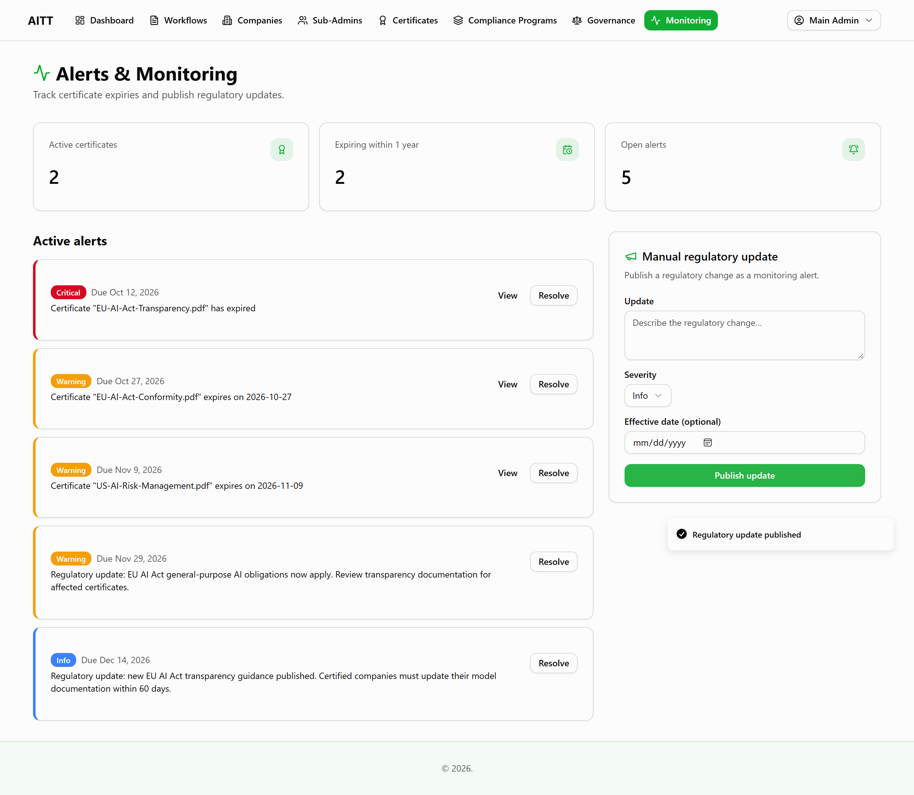

# AITT Compliance Platform — Delivery Report

**Repository:** https://github.com/Falparis/AITT-on
**Network:** Stellar testnet
**Canonical contract:** [`CDQQEMPK3F6ZKURO3CKOUD6GQZ6ZGWOZVENZ4U7BEVFLHDR4MBUN5TJC`](https://stellar.expert/explorer/testnet/contract/CDQQEMPK3F6ZKURO3CKOUD6GQZ6ZGWOZVENZ4U7BEVFLHDR4MBUN5TJC)

This report covers every point raised in the review, what was changed, and where each deliverable can be checked. A one-page checklist is in [DELIVERABLES.md](DELIVERABLES.md).

---

## Summary

| Area | Result |
|---|---|
| Multisig governance | Contract hardened (`init` guard, threshold bounds), redeployed, full governance flow executed on testnet with 13 public transactions |
| Canonical contract ID | One ID, used consistently across README, documentation and configuration examples |
| WASM reproducibility | Full Cargo project with pinned versions; anyone can rebuild and get the same WASM hash |
| Governance note | Key custody and quorum policy documented |
| Performance / load testing | Not performed — we request a modification of this deliverable |
| Compliance monitoring | Screenshots of the alerts and regulatory-update screens provided |
| Frontend | Actual frontend source published in `frontend/` |

---

## 1. Multisig Governance

### 1.1 Canonical contract

| | |
|---|---|
| Contract ID | [`CDQQEMPK3F6ZKURO3CKOUD6GQZ6ZGWOZVENZ4U7BEVFLHDR4MBUN5TJC`](https://stellar.expert/explorer/testnet/contract/CDQQEMPK3F6ZKURO3CKOUD6GQZ6ZGWOZVENZ4U7BEVFLHDR4MBUN5TJC) |
| WASM hash (SHA-256) | `f98e917479db7306b64a3866fc97118effc05d62e65fdc478986027141ab5e6e` |
| Governance | Threshold 2 of 3 sub-admins |

Earlier deployments used several different contract IDs across the README and documents. All references now point to this single contract: the root README, `contract/README.md`, the backend documentation (`backend/docs/*`), `backend/Technical Documentation.docx`, `backend/DEPLOYMENT.md` and the example configuration files.

### 1.2 Pre-mainnet fixes

Both requested fixes are implemented in the contract ([lib.rs](contract/contracts/document_verification_system/src/lib.rs)) and covered by unit tests:

**`init` cannot be called again.** Once the main admin is set, any further `init` call is rejected, so the main admin can never be reassigned through `init`. The deploy scripts call `init` immediately after deployment.

**`1 <= N <= number of sub-admins`.** The contract now tracks the number of sub-admins (`sub_admin_count`) and enforces the bound:

- `set_threshold` rejects 0 and any value above the number of sub-admins.
- `UpdateThreshold` proposals are checked when created and again when they execute.
- Removing a sub-admin never deadlocks governance: if fewer sub-admins would remain than the threshold, the threshold is lowered to the remaining count (minimum 1).
- Adding the same sub-admin twice does not inflate the count.

37 unit tests pass (`cargo test`), including the new guard and threshold tests.

### 1.3 Testnet transactions

The complete governance flow was executed on the canonical contract. Each link opens the transaction on the Stellar explorer.

| # | Step | Transaction |
|---|---|---|
| 1 | Upload WASM | [479eddd0…5d7aa4](https://stellar.expert/explorer/testnet/tx/479eddd081e9485fbe5b1f7c761de6828371301493fabb49dee112e75f5d7aa4) |
| 2 | Deploy contract | [36c59c30…f6bbdf](https://stellar.expert/explorer/testnet/tx/36c59c30039407665b039ae1e9752e6857eea844825634f12eb31fc725f6bbdf) |
| 3 | `init` | [2730db9e…6237f3](https://stellar.expert/explorer/testnet/tx/2730db9e68119ed3ea013223068bdfe6039f58b1ee69225f89aac3d71e6237f3) |
| 4 | `add_sub_admin` — Sub-admin A | [65c9c387…53427f](https://stellar.expert/explorer/testnet/tx/65c9c3872ea57be6558dbf2989d8a7ffc3d6535929479c8826f2fcc53103427f) |
| 5 | `add_sub_admin` — Sub-admin B | [f9a39d9e…4eb6c](https://stellar.expert/explorer/testnet/tx/f9a39d9e1e15bbac8bbd426e095e14ad78ea69188bddec8da70a27cbf974eb6c) |
| 6 | `add_sub_admin` — Sub-admin C | [e93e925b…a7c89](https://stellar.expert/explorer/testnet/tx/e93e925b7ed22126cce791a8c7a81f7ba3dccd4a0f49557cbcc569fefb5a7c89) |
| 7 | `set_threshold` = 2 | [741c6264…818d68](https://stellar.expert/explorer/testnet/tx/741c626489b412e123f31f9bf42144239f15a820f3dc8029c883b3702a818d68) |
| 8 | `whitelist_address` (company) | [776b7aa1…2773e](https://stellar.expert/explorer/testnet/tx/776b7aa1d997d049940fd867581074decab0605fc68822c656b1ed38c37f2d6a) |
| 9 | `store_document` (company) | [76451ea5…20420](https://stellar.expert/explorer/testnet/tx/76451ea5812196e9f3e303100f529914b6f5325cbfe80ef7c575142cecc20420) |
| 10 | `issue_certificate` | [fb7cdb24…df3f3](https://stellar.expert/explorer/testnet/tx/fb7cdb2488e5fc3e1802e8595e6b2517515f0f37174fc4d27ad92f1eda8df3f3) |
| 11 | `create_proposal` — RevokeCertificate | [b03dde09…17180](https://stellar.expert/explorer/testnet/tx/b03dde098f4fb79fdb3bd8c7d405b49f959a68746c49ca05f39b6a2a55f17180) |
| 12 | `approve_proposal` — Sub-admin A (1 of 2, not executed) | [6da6100b…e389a](https://stellar.expert/explorer/testnet/tx/6da6100b0f74b38427c5412c74bc0e4e8b564fe6950d98d29ff390d5c77e389a) |
| 13 | `approve_proposal` — Sub-admin B (2 of 2, **auto-executed**) | [a547235c…78d5b](https://stellar.expert/explorer/testnet/tx/a547235c59a05cab98e09b29463aeaa4d00e1aa7d1fc41e535162a4fe6878d5b) |

**Result:** the certificate was **Issued** before the proposal; after the first approval the proposal was not executed and the certificate stayed Issued; the second approval reached the threshold, the proposal executed automatically and the certificate became **Revoked**.

**Pre-mainnet guards verified on-chain:** a second `init` from another account was rejected and the main admin was unchanged; `set_threshold(4)` with 3 sub-admins and `set_threshold(0)` were both rejected.

The script that produced this run is [client_governance_demo.mjs](contract/scripts/client_governance_demo.mjs); the full record is [GOVERNANCE-TESTNET-PROOF.md](contract/GOVERNANCE-TESTNET-PROOF.md).

### 1.4 Governance note — keys and quorum

Full note: [contract/GOVERNANCE.md](contract/GOVERNANCE.md).

- **No-crypto model.** Companies and sub-admins sign in with email and password. They never handle a wallet, a seed phrase or XLM.
- **The backend holds the keys** of companies and sub-admins. Keys are generated by the backend, stored encrypted (AES-256-GCM), and used to sign on the user's behalf.
- **These accounts are empty.** Company and sub-admin accounts hold no XLM balance; they are created with sponsored reserves.
- **The main admin always pays the gas.** Every transaction is fee-bumped and paid by the main admin account, so users never pay fees and their accounts hold nothing of value.
- **Quorum policy.** Revocations, threshold changes and contract upgrades require N approvals from sub-admins, with `1 <= N <= number of sub-admins`. Currently N = 2 of 3, so no single sub-admin can revoke a certificate alone. Proposals execute automatically when N is reached.

### 1.5 WASM reproducibility

The contract is now a complete Cargo project in [contract/](contract/):

| File | Purpose |
|---|---|
| [Cargo.toml](contract/Cargo.toml) | Workspace and release profile |
| [Cargo.lock](contract/Cargo.lock) | Every dependency version pinned |
| [contracts/document_verification_system/](contract/contracts/document_verification_system/) | Contract source and unit tests |

Toolchain: Rust 1.96.0 (`wasm32v1-none`), Stellar CLI 27.0.0, soroban-sdk 27.0.6.

```bash
cd contract
stellar contract build
sha256sum target/wasm32v1-none/release/document_verification_system.wasm
# f98e917479db7306b64a3866fc97118effc05d62e65fdc478986027141ab5e6e
```

The resulting hash matches the WASM installed on the canonical contract. Step-by-step instructions: [contract/README.md](contract/README.md#build-and-reproduce-the-wasm-hash).

---

## 2. Performance and Load Testing

Load tests have **not been performed**. As advised, we request a modification of this deliverable.

---

## 3. Compliance Monitoring

The expiry job, alerts and manual regulatory-update endpoint were confirmed by the reviewers. The requested screenshots are below and in [docs/screenshots/](docs/screenshots/).

**Alerts screen** — certificate expiry alerts raised by the expiry job (critical for expired, warning for expiring soon) and a published regulatory update:



**Regulatory-update screen** — the manual regulatory-update form:



After publishing, the update appears in the alerts list:



### Frontend repository

The `frontend/` folder previously contained a copy of the backend. It now contains the **actual frontend source** (React, TypeScript, Vite), published under the same conditions as the rest of the repository.

---

## 4. Repository Map

| Path | Contents |
|---|---|
| [contract/](contract/) | Soroban smart contract, build setup, deploy and test scripts, governance note and testnet proof |
| [backend/](backend/) | Node.js / Express / MongoDB API, tests, API documentation, technical documentation |
| [frontend/](frontend/) | React / TypeScript / Vite web application |
| [docs/screenshots/](docs/screenshots/) | Compliance monitoring screenshots |
| [DELIVERABLES.md](DELIVERABLES.md) | Checklist mapping each request to its deliverable |
| [README.md](README.md) | Project overview, structure, setup |

---

## 5. How to Verify

1. **Contract and transactions:** open the [contract on the explorer](https://stellar.expert/explorer/testnet/contract/CDQQEMPK3F6ZKURO3CKOUD6GQZ6ZGWOZVENZ4U7BEVFLHDR4MBUN5TJC) and the 13 transaction links in section 1.3.
2. **Threshold:** call `governance_threshold` (returns 2) and `sub_admin_count` (returns 3) on the contract.
3. **WASM hash:** build as in section 1.5 and compare with the hash shown on the explorer.
4. **Unit tests:** `cd contract && cargo test` (37 passing).
5. **Monitoring:** see the screenshots in section 3.
